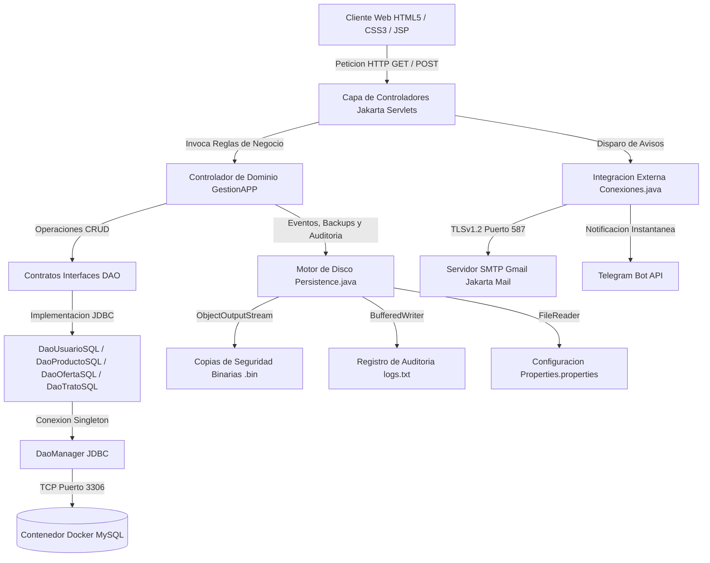

# FernanPop - Plataforma Web C2C con Arquitectura MVC y Persistencia Hibrida


Plataforma web de compraventa de articulos de segunda mano entre particulares (C2C) desarrollada en **Java** bajo una arquitectura **Modelo-Vista-Controlador (MVC)** estricta y el **Patron DAO**. El sistema combina persistencia relacional en un contenedor **MySQL sobre Docker** con **persistencia en disco local** (copias de seguridad binarias serializadas, auditoria de logs y emision de comprobantes), ademas de notificaciones externas mediante **SMTP (Jakarta Mail)** y **Telegram Bot API**.

---

## Arquitectura del Sistema

El proyecto separa de forma estricta la presentacion, el control de flujo HTTP, la logica de negocio centralizada y el acceso a datos:



---

## Caracteristicas Tecnicas Principales

### 1. Arquitectura MVC y Programacion Orientada a Objetos (POO)
* **Modelos de Dominio (`models/`)**: Entidades fuertemente encapsuladas (`Usuario`, `Producto`, `Oferta`, `Trato`) que implementan `Serializable` para permitir su transporte tanto hacia vistas JSP como hacia flujos binarios en disco.
* **Controladores HTTP (`controller/*Servlet.java`)**: Conjunto de Servlets especializados (`LoginServlet`, `RegistroServlet`, `ValidarServlet`, `InvitadoServlet`, `HacerOfertaServlet`, `GestionOfertaServlet`, `GuardarResenaServlet`, `LogoutServlet`) encargados de gestionar sesiones `HttpSession`, validar parametros de entrada y orquestar las respuestas.
* **Fachada de Negocio (`controller/GestionAPP.java`)**: Centraliza las reglas de negocio, coordina la reconstruccion de grafos de objetos (productos en venta, historial de compras/ventas y valoraciones pendientes) y ejecuta algoritmos de ordenacion en memoria por precio y fecha.

### 2. Patron DAO y Seguridad en Base de Datos (MySQL + Docker)
* **Separacion por Contratos (`DAO/`)**: Interfaces dedicadas (`DaoUsuario`, `DaoProducto`, `DaoOferta`, `DaoTrato`) desacopladas de sus implementaciones SQL (`DaoUsuarioSQL`, `DaoProductoSQL`, `DaoOfertaSQL`, `DaoTratoSQL`).
* **Gestor de Conexiones Singleton (`DaoManager.java`)**: Administra la conexion JDBC hacia la instancia MySQL contenerizada en Docker leyendo las credenciales mediante variables de entorno (`DB_URL`, `DB_USER`, `DB_PASS`).
* **Prevencion de Inyeccion SQL**: Todas las consultas e inserciones emplean `PreparedStatement` con asignacion tipada de parametros.

### 3. Doble Persistencia: Relacional (SQL) + Disco Local (I/O)
Ademas de la persistencia transaccional en MySQL, el paquete `persistence/Persistence.java` implementa operaciones directas sobre el sistema de ficheros:
* **Copias de Seguridad Binarias (`copiaSeguridad` / `leeUsuarios`)**: Serializacion completa de objetos `Usuario` junto con su historial de productos y tratos en archivos `.bin` mediante `ObjectOutputStream` y `ObjectInputStream`.
* **Auditoria de Actividad (`logs` / `leeLogs`)**: Trazabilidad cronologica de inicios de sesion, accesos en modo invitado, cierres de sesion y ventas cerradas en `logs.txt`.
* **Emision de Resumenes de Venta (`generaResumenVenta`)**: Generacion automatica en disco de comprobantes detallados por cada transaccion cerrada.
* **Parametrizacion Externa (`Properties.properties`)**: Configuracion de rutas de almacenamiento y permisos de modo invitado mediante `java.util.Properties`.

### 4. Comunicaciones Externas: SMTP (Jakarta Mail) y Telegram Bot
* **Activacion de Cuenta por Token (`UUID`)**: Al registrarse un usuario (`RegistroServlet`), se almacena en estado inactivo junto con un token `UUID` unico y se envia un correo con un enlace de verificacion dinamico (`ValidarServlet`).
* **Notificaciones Transaccionales HTML (`GestionOfertaServlet`)**: Cuando el vendedor acepta una oferta, el sistema transforma la oferta en un `Trato` en firme, actualiza el estado del producto a vendido y despacha dos correos electronicos independientes con plantillas HTML/CSS diferenciadas para comprador y vendedor.
* **Seguridad de Credenciales**: Ninguna clave de aplicacion de Gmail ni token de API se almacena en el codigo fuente; se inyectan a traves de variables de entorno (`SMTP_EMAIL`, `SMTP_TOKEN`, `TELEGRAM_BOT_TOKEN`).

### 5. Interfaz Web Adaptativa (HTML5, CSS3 y JSP)
* **Diseno Responsive Mobile-First (`style.css` y `navbar.jsp`)**: Barra de navegacion superior para escritorio y barra de navegacion fija inferior para dispositivos moviles.
* **Modo Invitado**: Permite explorar el catalogo publico y utilizar el motor de busqueda por texto sin requerir autenticacion previa, restringiendo las operaciones de escritura (publicar, ofertar, valorar) mediante control de sesion en `index.jsp`.

---

## Estructura del Proyecto

```text
fernan_pop/
├── src/
│   └── main/
│       ├── Properties/
│       │   └── Properties.properties        # Rutas de logs, backups y flag de modo invitado
│       ├── java/
│       │   ├── controller/
│       │   │   ├── GestionAPP.java          # Nucleo de logica de negocio y orquestacion
│       │   │   ├── LoginServlet.java        # Autenticacion de usuarios activos
│       │   │   ├── RegistroServlet.java     # Alta con generacion de token UUID y envio SMTP
│       │   │   ├── ValidarServlet.java      # Activacion de cuenta mediante token por URL
│       │   │   ├── InvitadoServlet.java     # Acceso de solo lectura al catalogo
│       │   │   ├── HacerOfertaServlet.java  # Registro de propuestas economicas
│       │   │   ├── GestionOfertaServlet.java# Aceptacion/rechazo, creacion de trato y avisos HTML
│       │   │   ├── GuardarResenaServlet.java# Puntuacion (1-5) y comentario post-venta
│       │   │   └── LogoutServlet.java       # Invalidacion segura de sesion HTTP
│       │   ├── DAO/
│       │   │   ├── DaoManager.java          # Conexion Singleton JDBC (variables de entorno)
│       │   │   ├── DaoUsuario.java / SQL    # Operaciones SQL de usuarios y validacion token
│       │   │   ├── DaoProducto.java / SQL   # Catalogo, busqueda textual e historial
│       │   │   ├── DaoOferta.java / SQL     # Gestion de ofertas activas por producto
│       │   │   └── DaoTrato.java / SQL      # Persistencia de compras, ventas y resenas
│       │   ├── models/
│       │   │   ├── Usuario.java             # Modelo serializable de usuario
│       │   │   ├── Producto.java            # Modelo de articulo en venta
│       │   │   ├── Oferta.java              # Propuesta economica vinculada
│       │   │   └── Trato.java               # Transaccion cerrada y calificacion
│       │   ├── persistence/
│       │   │   └── Persistence.java         # Serializacion binaria .bin, logs y resumenes
│       │   └── utils/
│       │       ├── Conexiones.java          # Cliente SMTP TLSv1.2 (Jakarta Mail) y APIs
│       │       └── Utils.java               # Formateadores de fecha Calendar <-> SQL
│       └── webapp/
│           ├── WEB-INF/web.xml              # Descriptor de despliegue Jakarta EE
│           ├── style.css                    # Hoja de estilos responsive
│           ├── index.jsp                    # Enrutador de vistas y guardia de seguridad
│           ├── navbar.jsp                   # Navegacion adaptativa PC / Movil
│           ├── inicio.jsp                   # Buscador y grid del catalogo
│           ├── producto.jsp                 # Ficha de detalle y envio de oferta
│           ├── publicar.jsp                 # Formulario de alta de articulos
│           ├── ofertas.jsp                  # Bandeja de ofertas recibidas (Aceptar/Rechazar)
│           ├── tratos.jsp                   # Historial de compras/ventas y formulario de resena
│           ├── misProductos.jsp             # Panel de articulos propios en venta
│           ├── ajustes.jsp                  # Edicion de perfil de usuario
│           ├── login.jsp / registro.jsp     # Vistas de autenticacion y registro
│           └── error.jsp                    # Pagina de captura global de excepciones
├── .env.example                             # Plantilla de variables de entorno (sin secretos)
├── .gitignore                               # Reglas de exclusion de binarios, logs y credenciales
└── pom.xml                                  # Dependencias Maven (Jakarta Servlet 6.1, MySQL, Mail)
```

---

## Configuracion y Despliegue Local

### 1. Levantar la Base de Datos en Docker
Ejecuta un contenedor MySQL 8+ mapeando el puerto `3306`:

```bash
docker run -d \
  --name fernanpop-mysql \
  -e MYSQL_ROOT_PASSWORD=db_password \
  -e MYSQL_DATABASE=fernanPop \
  -e MYSQL_USER=db_user \
  -e MYSQL_PASSWORD=db_password \
  -p 3306:3306 \
  mysql:8.0
```

### 2. Configurar Variables de Entorno
Copia el archivo `.env.example` o define las siguientes variables de entorno en la configuracion de ejecucion de tu servidor de aplicaciones (Apache Tomcat 10.1+ / GlassFish):

```env
DB_URL=jdbc:mysql://localhost:3306/fernanPop?useSSL=false&allowPublicKeyRetrieval=true&serverTimezone=Europe/Madrid
DB_USER=db_user
DB_PASS=db_password
SMTP_EMAIL=tu_correo@gmail.com
SMTP_TOKEN=xxxx xxxx xxxx xxxx
TELEGRAM_BOT_TOKEN=0000000000:AAHxxxxxxxxxxxxxxxxxxxxxxxxxxxxxxxx
TELEGRAM_CHAT_ID=000000000
```

### 3. Compilar el Empaquetado WAR con Maven
```bash
./mvnw clean package
```
El artefacto generado en `target/FernanPop-1.0-SNAPSHOT.war` esta listo para desplegarse en cualquier contenedor compatible con **Jakarta Servlet 6.0+**.

---

## Autor

**Angel Miranda Molina**
* GitHub: [@Angeell04](https://github.com/Angeell04)
* Portfolio Web: [angeell04.netlify.app](https://angeell04.netlify.app)
* LinkedIn: [Angel Miranda](https://www.linkedin.com/in/%C3%A1ngel-miranda-75966b344/)
